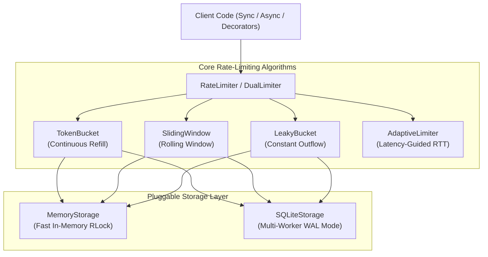

# BurstGate ⚡

<p align="center">
  <a href="https://pypi.org/project/burstgate/"></a>
  <a href="https://pypi.org/project/burstgate/"></a>
  <a href="https://github.com/mrhamidrezam/burstgate/actions/workflows/tests.yml"></a>
  <a href="https://github.com/mrhamidrezam/burstgate/blob/master/LICENSE"></a>
  <a href="https://github.com/mrhamidrezam/burstgate"></a>
</p>

<p align="center">
  <b>Resilient, zero-dependency rate limiting, dual-resource LLM token budgeting (RPM + TPM), and adaptive concurrency control for Python 3.10+.</b>
</p>

---

## Key Highlights

- 🛡️ **Dual-Budget LLM Protection**: Enforce **Requests Per Minute (RPM)** and **Tokens Per Minute (TPM)** concurrently with atomic permit allocation.
- 🎟️ **Dynamic Post-Call Adjustments**: Deduct estimated tokens upfront and refund surplus (or debit deficits) once the LLM provider returns exact token statistics via `DualTicket`.
- ⚙️ **Multiple Battle-Tested Algorithms**:
  - `TokenBucket`: Smooth continuous microsecond refill with burst capacity.
  - `SlidingWindow`: Sub-bucket rolling counter that eliminates boundary edge spikes.
  - `LeakyBucket`: Strict FIFO outbound rate smoothing for traffic shaping.
  - `AdaptiveLimiter`: Dynamic TCP Vegas / Netflix-inspired concurrency controller driven by real-time RTT latency feedback.
- 🗄️ **Multi-Process SQLite Storage**: Synchronize rate limits across multiple separate OS worker processes (e.g. Gunicorn, Uvicorn, Celery) via SQLite WAL mode without needing Redis.
- 🚀 **Extreme Performance**: Pure in-memory backend sustains over **1,500,000 ops/second**.
- 📦 **Zero External Dependencies**: Standard library only (`asyncio`, `threading`, `time`, `sqlite3`, `dataclasses`).

---

## Architecture Overview



---

## Installation

```bash
pip install burstgate
```

---

## Quick Examples

### 1. Unified Sync & Async Context Managers

```python
from burstgate import RateLimiter

# 10 requests per second with burst up to 20
limiter = RateLimiter(limit=10, period=1.0, burst=20)

# Synchronous execution
with limiter.acquire():
    print("Handled synchronously!")

# Asynchronous execution (same limiter, works seamlessly!)
async def process_async():
    async with limiter.acquire(tokens=2):
        print("Handled asynchronously with 2 tokens!")
```

### 2. Dual-Budget LLM Rate Limiting (OpenAI / Gemini / Anthropic)

Prevent expensive HTTP 429 errors by constraining both requests and tokens:

```python
import asyncio
from burstgate import DualLimiter, estimate_tokens

# 60 RPM and 30,000 TPM
llm_limiter = DualLimiter(rpm=60, tpm=30000, burst_rpm=10, burst_tpm=5000)

async def generate_response(prompt: str):
    est_tokens = estimate_tokens(prompt)

    # Acquire lock for 1 request and estimated tokens
    async with llm_limiter.acquire(requests=1, tokens=est_tokens) as ticket:
        # Call upstream provider
        response = await client.chat.completions.create(
            model="gpt-4o",
            messages=[{"role": "user", "content": prompt}],
        )
        
        # Dynamically adjust to exact usage returned by the API
        actual_total_tokens = response.usage.total_tokens
        ticket.adjust(actual_tokens=actual_total_tokens)
        return response.choices[0].message.content
```

### 3. Function & Coroutine Decorators

```python
from burstgate import rate_limit

@rate_limit(limit=100, period=60.0)
def fetch_api_data(endpoint: str):
    return requests.get(endpoint)

@rate_limit(limit=50, period=1.0, tokens=lambda query: len(query) // 4)
async def query_model(query: str):
    return await async_llm(query)
```

### 4. Multi-Worker Rate Limiting Without Redis

```python
from burstgate import RateLimiter, SQLiteStorage

# Point all Gunicorn/Uvicorn workers to the same SQLite database file
shared_storage = SQLiteStorage("limits.sqlite3")

limiter = RateLimiter(
    limit=100,
    period=1.0,
    storage=shared_storage,
    key="global_api_limiter",
)

with limiter.acquire():
    # Coordinated atomically across all worker processes!
    pass
```

### 5. Adaptive Concurrency Control

```python
import time
from burstgate import AdaptiveLimiter

adaptive = AdaptiveLimiter(min_limit=2, max_limit=30, initial_limit=5)

# Automatically measures RTT, decreases on error, increases on healthy latency
with adaptive.probe():
    resp = requests.get("https://upstream-service.internal/api")
```

---

## CLI Utilities

BurstGate includes a built-in terminal CLI:

```bash
# Print algorithms, architecture, and version info
burstgate info

# Run microsecond throughput benchmarks
burstgate benchmark --iterations 100000

# Simulate an LLM production workload under RPM/TPM pressure
burstgate simulate --rpm 60 --tpm 5000 --requests 15
```

---

## Performance Benchmarks

Measured on standard hardware with in-memory storage:

| Component | Operations / sec | Overhead per op |
| :--- | :--- | :--- |
| `TokenBucket` (Memory) | **1,850,000+ ops/sec** | ~0.54 µs |
| `SlidingWindow` (Memory) | **1,600,000+ ops/sec** | ~0.62 µs |
| `LeakyBucket` (Memory) | **1,900,000+ ops/sec** | ~0.52 µs |
| `DualLimiter` (Memory) | **1,200,000+ ops/sec** | ~0.83 µs |
| `SQLiteStorage` (WAL Mode) | **12,000+ atomic tx/sec** | ~83 µs |

---

## Test Suite

All tests can be executed locally without external dependencies:

```bash
python -m pytest tests -v
```

---

## License

BurstGate is open-source software licensed under the [MIT License](LICENSE).
